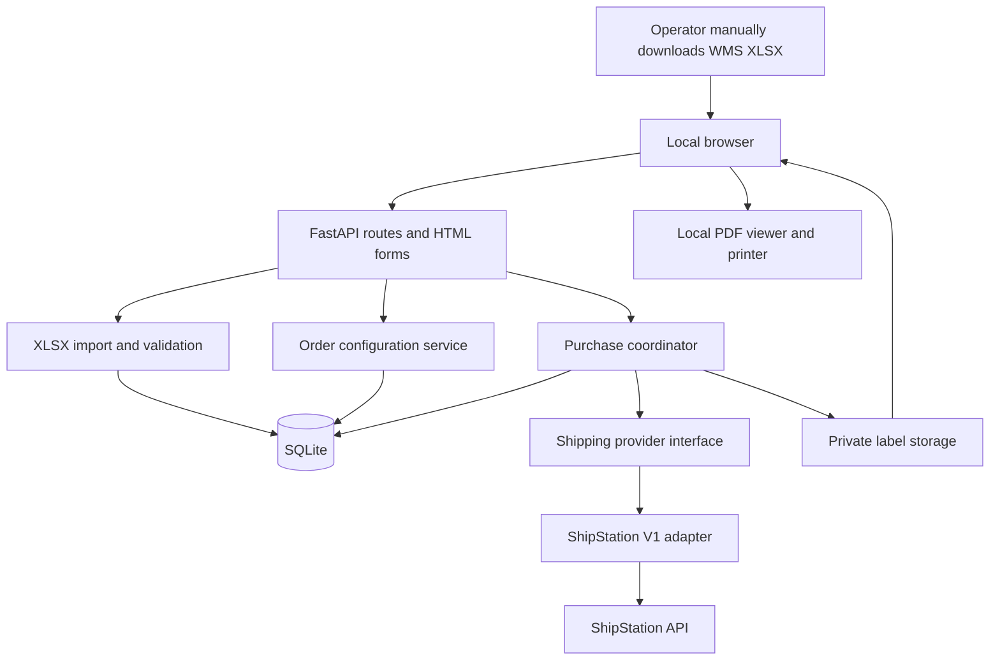

# WMS2ShipStation architecture and technology stack

Status: proposed implementation design for review. Updated: 2026-10-17.
Requirements: [English PDR](../PDR.md), [中文 PDR](../PDR.zh-CN.md).
Database: [schema design](DATABASE.md), [SQLite reference DDL](schema.sqlite.sql).

## Design decisions

Build a modular Python web application with server-rendered pages. Run it on the operator's computer first, with one application process, SQLite, and private local file storage. This is sufficient for the expected initial volume of fewer than 10 orders/day and the planning envelope of fewer than 100/day. These are workload assumptions to validate, not measured capacity guarantees.

Keep the core order/package model independent of ShipStation. ShipStation V1 is the first provider adapter; additional providers can be implemented without changing spreadsheet import or losing purchase history. Direct shipment-label creation is confirmed: do not create ShipStation orders first.

A separate React frontend, Redis, Kubernetes, and a distributed queue would add deployment work without a current requirement. Server-rendered forms can support import, review, per-order configuration, purchase confirmation, and history. Introduce a richer frontend only if the editing workflow later requires it.

## Recommended stack

| Concern | MVP choice | Reason and later evolution |
| --- | --- | --- |
| Runtime | Python 3.12 baseline; uv dependency lockfile | Shared language for XLSX parsing, business rules, and API integration. Pin compatible patch/package versions during implementation. |
| Web/API | FastAPI + Uvicorn | Typed request models and an explicit HTTP API alongside HTML pages. One process locally. |
| UI | Jinja2 templates, plain CSS, small JavaScript modules | Same-origin app with simple forms, status polling, and browser PDF printing; no separate frontend build required. |
| Validation | Pydantic + domain validation functions | Separate type/shape checks from carrier, customs, and purchase eligibility rules. |
| Excel | openpyxl, read-only parsing | Read `.xlsx`; no legacy `.xls` or formula execution. Explicitly validate sheets, headers, units, and joins. |
| Persistence | SQLAlchemy 2 + Alembic + SQLite | Explicit transactions and versioned migrations. Switch to PostgreSQL before shared cloud deployment. |
| Provider HTTP | HTTPX with explicit timeouts | Centralize authentication, redaction, rate-limit handling, and error classification. Never automatically retry purchases after an ambiguous result. |
| Label storage | Private filesystem behind a storage interface | Store original PDF bytes and checksums. Later replace storage with private object storage. |
| Letter PDF | Provider PDF when suitable; pypdf for Letter composition if needed | Preserve originals. Validate printed dimensions and barcode readability; never assume a returned PDF is Letter-size. |
| Verification | pytest, HTTPX mocks, browser smoke checks | Focus on import correctness, purchase safety, recovery, and printable output. No real purchases in automated tests. |
| Packaging | Docker image + Docker Compose locally | One application container with persistent local data volume; use the same application image on Cloud Run. |
| Cloud later | Google Cloud Run, Cloud SQL for PostgreSQL, Cloud Storage, Secret Manager, authenticated login | Google Cloud is confirmed as the future platform. No cloud resources provisioned by this design. |

These are project recommendations, not vendor requirements. Exact dependency versions must be locked and checked together when implementation begins.

## Components and data flow



- Import module preserves source file/sheet/row provenance and raw normalized evidence. Re-imports link to existing orders without overwriting configured or purchased data.
- Order module owns recipient, package, item, and per-order shipping configuration. The configured Katy address is used for both ship-from and returns. Country scope is US/CA.
- Purchase coordinator validates, reserves packages, records immutable intent, calls the provider, and records outcomes. It owns duplicate prevention across providers.
- Provider adapter translates canonical data into provider fields and normalizes results. Provider credentials and API-specific types never reach browser code.
- Artifact service delivers stored labels and creates a Letter presentation when needed. Download/reprint performs no purchase call.
- History service exposes orders, attempts, provider references, tracking, and reconciliation events for manual WMS entry.

## Import and configuration workflow

1. Upload `.xlsx` with an explicit size, uncompressed-size, sheet, and row limit. Provisional engineering limits: 10 MiB compressed, 100 MiB uncompressed, and 1,000 data rows per sheet; confirm against real bulk exports. Reject encrypted workbooks, unsupported layouts, and formula cells in required fields rather than trusting cached formula values.
2. Normalize documented headers, including line breaks. Preserve order identifiers, phone numbers, and postal codes as text. Flag ambiguous identifiers already damaged by Excel numeric conversion.
3. Parse each source order and package with stable source keys. Do not infer package identity solely from mutable dimensions. Until multi-package and multi-location samples establish mapping rules, block ambiguous cases with an actionable message.
4. Persist provenance and an import summary. Identical file hashes can produce a duplicate warning, but order/package identity is the authoritative duplicate key. Changed source data requires explicit review, never silent overwrite.
5. Configure each order: complete warehouse/contact details, carrier/service, package type, shipping date/options, and applicable Canada customs fields. Return address equals ship-from. Validate before purchase; broader imported-field editing can follow later.
6. Freeze the reviewed order version and package set for purchase. Subsequent draft edits cannot change an existing purchase snapshot.

## Safe label purchase

A local request token prevents a double click from creating two application attempts. It is not a guarantee of provider-side idempotency.

1. On explicit Create label, verify the submitted order version and server-side validation. Treat carrier/service/package codes as account-scoped values fetched through the adapter.
2. In a short database transaction, create the attempt and acquire one guard per package. Unique package guards block any concurrent or later purchase, including with another provider, while an outcome is unresolved or a valid purchase exists. Commit before external I/O.
3. Persist the normalized request snapshot and mark the attempt `sending` before network transmission. Do not hold a database transaction open during the API call.
4. On confirmed success, durably record provider references and tracking, and write the original PDF atomically. Mark `purchased` even if PDF storage fails: retain guards and show artifact recovery required. Missing PDF does not authorize repurchase.
5. On a proven rejection with no purchase, mark `failed` and release guards transactionally. On timeout, connection interruption after possible transmission, malformed success response, unexpected server errors, or crash, mark `uncertain` and retain guards. No automatic purchase retry.
6. Reconcile using provider evidence and identifiers when available, or operator investigation in ShipStation/support. Record evidence. Only a confirmed no-purchase outcome releases guards; a confirmed purchase creates/repairs the result and artifacts. Never infer failure merely because an immediate search finds nothing.

At startup, abandoned `sending` attempts become `uncertain`. Interrupted `prepared` attempts remain blocked for review; no background process blindly resends them. Provider read requests may retry with bounded backoff according to documentation. Batch operations run as individual attempts sequentially for MVP; one failure must not roll back another successful purchase.

Replacement and voiding are excluded from automatic MVP behavior. A future replacement must explicitly reference the previous result and preserve its audit trail; do not implement a generic force-buy button.

## Provider contract

```text
list_carriers() / list_services(carrier) / list_package_types(carrier)
validate_shipment(canonical_snapshot) -> issues
create_label(canonical_snapshot, local_attempt_id) -> purchase_result
reconcile(attempt_evidence) -> purchased | confirmed_not_purchased | unresolved
```

The contract exposes capability flags for rates, voiding, label retrieval, and multi-package requests. Do not pretend every provider can reconcile automatically or accepts the local attempt ID as an idempotency key. MVP supports one unambiguous package per purchase; future multi-package adapters must define atomicity and partial results before activation.

ShipStation V1 uses `POST /shipments/createlabel`. Confirm an active Manual Store and account capabilities during setup. Retrieve available carrier/service/package codes rather than hard-coding display names. Validate actual Letter output and Canadian declaration mapping against the endpoint before enabling live purchases.

## Application HTTP surface

| Route | Purpose |
| --- | --- |
| `POST /api/imports` | Parse and persist an XLSX import; no purchase. |
| `GET /api/imports/{id}` | Import summary and row issues. |
| `GET /api/orders` / `GET /api/orders/{id}` | Review drafts, source provenance, history. |
| `PATCH /api/orders/{id}` | Version-checked per-order configuration. |
| `GET /api/providers/{id}/carriers` | Available shipping choices through the server. |
| `POST /api/orders/{id}/validate` | Eligibility and field-level errors. |
| `POST /api/orders/{id}/label-attempts` | Explicit purchase with request token and reviewed version. |
| `GET /api/label-attempts/{id}` | Outcome and reconciliation status. |
| `GET /api/labels/{id}/pdf` | Download stored original or Letter artifact. |

HTML routes call the same services. Mutation requests require same-origin checks and CSRF protection. Use stable structured error codes and field paths; never return provider secrets or unsanitized exception payloads.

## Local operation and cloud migration

For native local execution, bind to `127.0.0.1`. For Docker, listen on `0.0.0.0` inside the container and publish only to host loopback (for example `127.0.0.1:8080:8080`). Validate Host/Origin, disable permissive CORS, and run one process. No application login is proposed for the trusted local-only MVP; the machine user has full access. Do not expose this mode to a LAN or the public Internet. Credentials come from server environment/local private configuration excluded from Git. Database, source files, and labels also stay outside the repository.

Enable SQLite foreign keys on every connection, WAL mode, and a busy timeout. Use short write transactions and conditional version updates. Back up through SQLite's backup API, together with label files and a checksum manifest; test restore. Keep all shipment history and label artifacts for now. Raw uploads are temporary during parsing unless a separate retention policy is approved; persist provenance/hash and necessary normalized evidence, not an indefinite copy of every workbook.

Docker is the standard deployment package. During implementation, add a Dockerfile, `.dockerignore`, and Compose configuration. Run as a non-root user, install locked dependencies, exclude secrets/data/Git metadata from the image, and mount a persistent local volume for SQLite and labels. Keep environment-specific configuration outside the image. Native Python remains an optional development workflow. No working Docker image exists yet because the application has not been implemented.

For Google Cloud, push the image to Artifact Registry and deploy to Cloud Run. Build for `linux/amd64` (or a multi-architecture image containing it); a local Apple Silicon build must not accidentally produce only an ARM image. Listen on `0.0.0.0:$PORT` in Cloud Run. Container-local files are ephemeral, so use Cloud SQL for PostgreSQL and private Cloud Storage for durable records and labels; do not run the production SQLite database on Cloud Run's writable filesystem. Use a dedicated service account and Secret Manager for provider credentials. Ship structured redacted logs to Cloud Logging. Run schema migrations as a controlled deployment task, not concurrently on every web instance startup.

Cloud purchases must complete within a request or a durable worker/task execution; do not rely on an in-process background task continuing after the HTTP response. If Cloud Tasks is introduced, retries must consult the stored attempt and guards before any external purchase call. Unexpected instance termination leaves the attempt blocked for reconciliation. Initially limit instances and concurrency conservatively, but retain database guards as the correctness mechanism. Select an authentication implementation before deployment and keep cloud access restricted until it is configured.

Before cloud deployment: migrate to PostgreSQL using an explicit data migration and reconciliation check, move artifacts to private object storage, add authenticated identities even if every user initially has full access, and replace the local actor with real user IDs. Use DB uniqueness/transactions for purchase guards across instances. Add row locking or compare-and-set logic and durable job scheduling before introducing multiple workers. Distinct roles can follow; authentication cannot wait until after public exposure.

Back up the local data first, copy artifacts with checksums, compare record counts and active guards, test reprint/reconciliation, then switch over with local purchase writes disabled. SQLite-to-PostgreSQL is not merely a connection-string change. Money, date, JSON, foreign-key, and constraint behavior need migration tests.

## Implementation plan and verification

1. Scaffold app, migrations, storage abstraction, synthetic XLSX fixtures, and local startup.
2. Implement import, duplicate detection, preview, per-order forms, and validation.
3. Implement purchase state machine with a fake provider; verify double clicks, concurrent requests, timeouts, crash recovery, partial batches, changed re-imports, and missing artifacts.
4. Implement ShipStation account discovery and direct-label adapter. Use mocked API responses for routine tests; require a separate explicit operator action for any real paid label.
5. Verify Letter PDFs on the available printer, barcode readability, reprinting without purchase, tracking display, and backup/restore.
6. Cloud migration and other providers are later projects after the local workflow is accepted.

## Official references

Reviewed 2026-10-17. These sources support integration/library capabilities; the architecture choices above are project decisions.

- [FastAPI documentation](https://fastapi.tiangolo.com/): typed Python APIs and validation integration.
- [SQLAlchemy SQLite dialect](https://docs.sqlalchemy.org/en/20/dialects/sqlite.html): transaction and foreign-key behavior.
- [openpyxl documentation](https://openpyxl.readthedocs.io/en/stable/): XLSX parsing.
- [ShipStation V1 direct-label endpoint](https://www.shipstation.com/docs/api/shipments/create-label/): request and label response contract.

- [Cloud Run container contract](https://cloud.google.com/run/docs/container-contract): image architecture, listening port, and ephemeral filesystem.
- [Cloud SQL connections from Cloud Run](https://cloud.google.com/sql/docs/postgres/connect-run).
- [Secret Manager integration with Cloud Run](https://cloud.google.com/run/docs/configuring/services/secrets).
