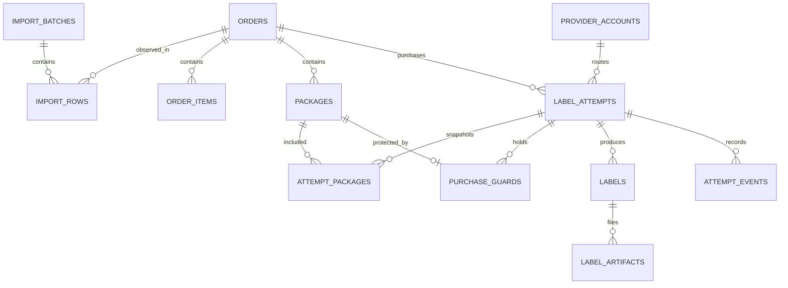

# Database design

Status: proposed schema for the local MVP, 2026-10-17. See [architecture](ARCHITECTURE.md) and [executable SQLite reference](schema.sqlite.sql). The SQL is a design artifact, not an installed application database or a replacement for Alembic migrations.

## Conventions

Application-generated UUID strings identify records. UTC timestamps are ISO-8601 strings locally; shipping dates remain date-only values paired with an explicit timezone in configuration. PostgreSQL migration should use native UUID/timestamptz/date types where appropriate.

Amounts use integer minor currency units plus currency code, with application validation of currency precision. Item customs unit values are stored as decimal strings in JSON and converted using Decimal, never binary floats. Package dimensions use integer millimetres and weight integer grams; retain source units/values in provenance and reject unsupported precision instead of silently rounding.

JSON is valid JSON text in the reference SQLite DDL. Validate payload schemas in the application; use JSONB in PostgreSQL if helpful. Normalized shipping data, not provider request objects, is authoritative. No API secrets are stored in these tables.

## Table responsibilities

| Table | Key fields / purpose | Constraints and lifecycle |
| --- | --- | --- |
| `import_batches` | Original filename, SHA-256, parser version, timestamps, summary | Hash indexed but not unique: retain separate import events and detect duplicate content. No required permanent raw-file copy. |
| `import_rows` | Batch, sheet, row number, source order key, normalized evidence, issues, optional linked order | Unique location per batch. Invalid rows can exist without an order. May represent evidence from either workbook sheet. |
| `orders` | Unique WMS order number, platform reference, recipient JSON, per-order origin JSON, shipping/customs JSON, version | Current editable draft. Origin is used for returns too. Purchased attempts remain immutable snapshots. |
| `order_items` | Stable source item key, SKU/description, integer quantity, customs JSON | Unique key per order; do not aggregate uncertain multi-location quantities. |
| `packages` | Stable package key per order, dimensions, weight, existing source tracking | Unique order/package key. Purchase eligibility requires all positive measurements. No destructive package renumbering after purchase. |
| `provider_accounts` | Provider code, display name, server credential reference, enabled flag | Credential reference points to environment/secret manager, never the credential value. |
| `label_attempts` | Order/account, reviewed version, local request token, state, immutable normalized snapshot, provider evidence, actor | Request token unique. `prepared`, `sending`, `purchased`, `failed`, `uncertain`. Outcome and artifact availability are separate. |
| `attempt_packages` | Immutable attempt/package membership | Composite primary key; retains which packages a purchase covers. MVP sends one package per attempt. |
| `purchase_guards` | One current guard per package, linked to attempt/package membership | Package primary key blocks duplicate buys across providers. Retain for purchased/uncertain attempts. Release only after confirmed no-purchase or an approved future replacement workflow. |
| `labels` | Attempt/package, provider shipment/label IDs, tracking, charge/currency | One result per attempt/package. Provider ID may be absent; do not invent it or treat tracking as globally unique. |
| `label_artifacts` | Label, kind (`original` or `letter`), storage key, hash, bytes | Private storage reference. One artifact of each kind per label. Original bytes preserved. |
| `attempt_events` | Attempt, actor, event type, evidence, timestamp | Append-only application audit trail for transitions/reconciliation. Avoid full API payloads or unnecessary PII. |

Recipient JSON: name, company, phone, email, address lines, city, state, postal code, country. Origin JSON uses the same address shape and must be a complete US Katy warehouse address before purchase. Shipping JSON: ship date, timezone, selected account-scoped carrier/service/package codes, residential, confirmation, insurance, duties options. Customs JSON: contents type and item declarations (referenced by item ID) with quantity, description, unit value/currency, origin, and HS code where required. Validation must check declaration quantities against order items.

## Transaction invariants

- An order's WMS number is unique across the current installation. There is no SaaS tenant model yet; multiple future users can share the same business data. Add a tenant namespace before hosting separate businesses.
- Save draft edits with `UPDATE ... WHERE id = ? AND version = ?`, incrementing version. Refuse stale writes and stale purchase submissions.
- Validate that every selected package belongs to the attempt's order and freeze item/configuration data in `request_snapshot_json`. Cross-order membership requires application validation inside the purchase transaction; the DDL does not enforce this cross-table rule.
- Insert attempt, membership, and guards in one transaction. A guard collision aborts the new attempt. All purchase entry points use these same guards.
- Every `sending`, `uncertain`, and `purchased` attempt retains guards for all its packages. State transitions and guard release occur in one transaction. The SQL cannot prove remote outcomes or enforce these service-level rules by itself.
- Record provider response identifiers as soon as durably possible. File writes use a temporary file plus atomic rename. If storage or DB finalization fails after remote success, recover using persisted evidence; never infer that another purchase is needed.
- A browser repeat with the same request token returns the existing attempt; if the token is reused for a different order, version, or payload, reject it.
- A successful label remains a purchase even if artifacts are missing. Reprints only read stored artifacts or explicitly recover the same provider purchase.
- `failed` means confirmed no purchase; `uncertain` means a purchase may exist. Only evidence-backed reconciliation may change an uncertain attempt to failed or purchased.
- Retain all history. Restrictive foreign keys prevent accidental cascade deletion. Application APIs do not expose hard deletion of history.

## Schema boundaries and migration

Draft values may be incomplete, so address/configuration JSON and dimensions can be null until the user finishes configuration. Application validation gates purchase; database constraints prevent invalid non-null measurements and malformed JSON.

The reference schema intentionally omits users/roles, queues, rate caches, automatic voids, and permanent raw-upload storage. Actor strings use a local identity initially; migrate to authenticated user references before cloud access. Before multi-package support, add explicit item-to-package allocation if required by the provider/customs workflow.

Implement migrations using Alembic. Test SQLite foreign keys, guard uniqueness, stale versions, cross-order membership rejection, transaction rollback, and restore behavior. For the confirmed Google Cloud deployment, use Cloud SQL for PostgreSQL and store label artifacts in private Cloud Storage. Local Docker runs keep SQLite and labels on a persistent volume. On PostgreSQL migration, replace SQLite-specific JSON checks/PRAGMAs and verify every invariant with real concurrent transactions.

### Saved shipper contacts

Migration `0002` adds `shipper_contacts` (`id`, `label`, `address_json`). The
address uses the existing order origin fields. Selecting a contact copies its
values into the order editor; saving the order stores an independent snapshot
in `orders.origin_json`. Editing or deleting a contact does not update orders
or historical label request snapshots. Contacts are included in database backups.
