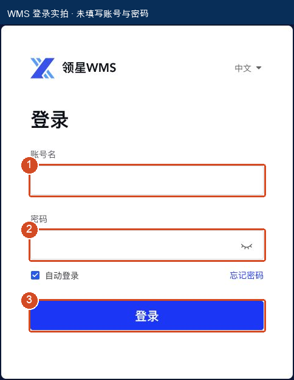
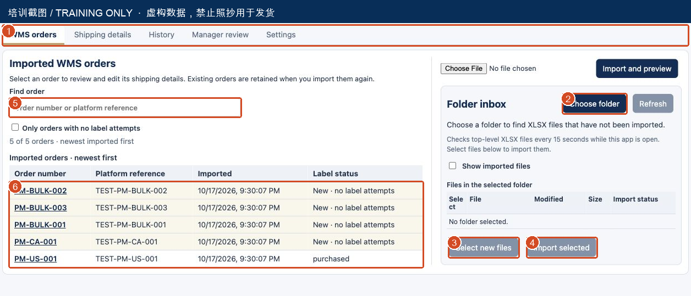
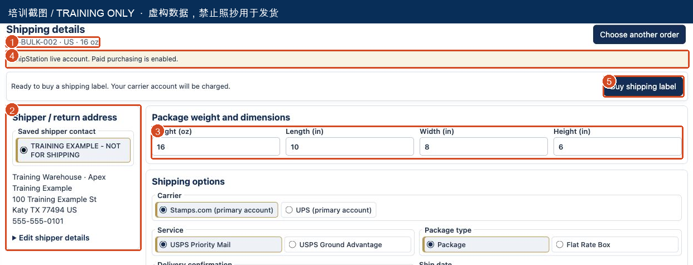
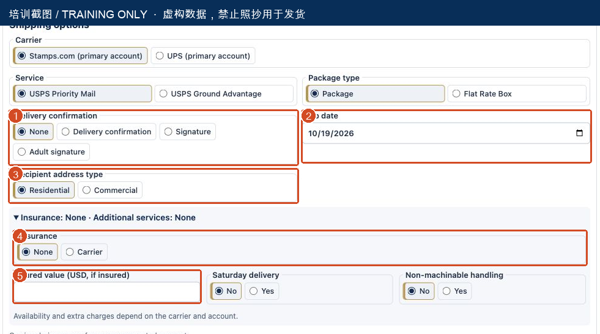
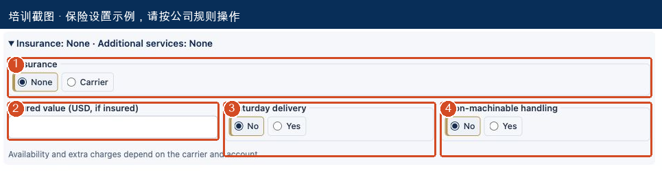
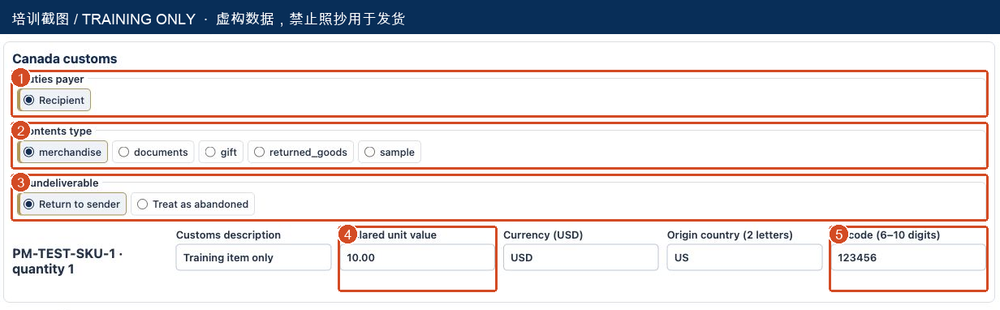
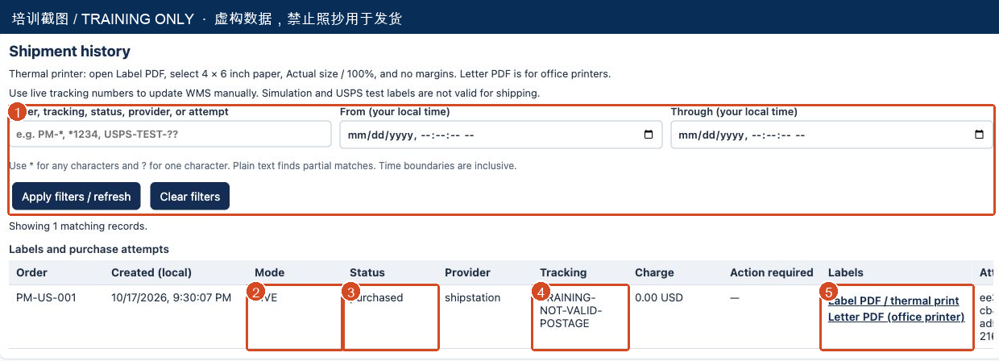
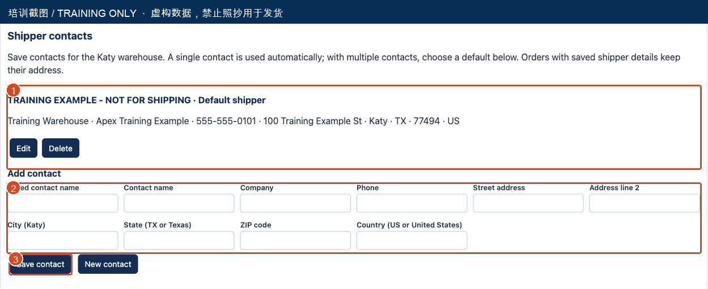
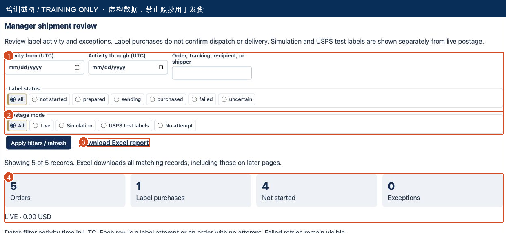

# WMS → WMS2ShipStation 新员工发货操作手册

版本：1.0｜编制日期：2026-10-17｜适用：Katy 仓库、本地 Mac 工作站、4×6 英寸热敏标签打印机。

**目标：** 按顺序完成一票美国国内订单：登录 WMS → 导出 XLSX → 保存到指定文件夹 → 导入订单 → 核对包裹和服务 → 购买正式运单 → 打印贴标 → 回填 WMS → 交接。

> **使用前必读**：本机已启用正式购买。点击 **Buy shipping label** 并确认，会向已连接的承运商账户购买运单。培训截图使用独立环境和虚构数据，图片里的地址、单号、日期、服务与金额都不是操作指令。

> **本版待主管补齐**：WMS 登录后具体导出菜单、待发货筛选条件、跟踪号回填菜单，以及最终统一文件夹路径尚未提供。相关位置明确标为【待主管确认】，不得把推测当作实际菜单。WMS 登录页已实拍；系统操作部分已按当前界面制作。

### 本手册怎么读

| 阶段 | 阅读位置 |
| --- | --- |
| 第一天准备 | 01–04：权限、WMS 登录、导出和保存 |
| 每票操作 | 05–09：导入、核对、美国单位、服务和购买 |
| 打印与收尾 | 10–13：加拿大补充、历史、4×6 打印、WMS 回填 |
| 主管与异常 | 14A–16：发货人、报表、异常、验收清单 |

## 01｜上岗前：确认入口、权限和用品

### 第一天先找谁、准备什么

由带教主管确认你能操作哪些订单、使用哪个仓库、选哪种物流服务，以及哪些情况必须请主管处理。首次实际付费发货请由带教人员陪同核对。

| 项目 | 要求 / 填写位置 |
| --- | --- |
| WMS 登录网址 | https://wms.xlwms.com |
| WMS 账号 | 使用公司分配给本人的账号；不要把密码写进本手册 |
| WMS 订单导出路径 | 【待主管确认：实际菜单 → 实际订单列表 → 导出按钮】 |
| 导出订单筛选条件 | 【待主管确认：仓库、状态、日期、订单范围】 |
| 正式发货系统 | 本机 Chrome 或 Edge 打开 http://localhost:8082 |
| 导出保存文件夹 | 示例：桌面 / WMS订单导出；最终路径【待主管确认】 |
| 打印设备 | 已安装驱动的 4×6 英寸热敏标签打印机、匹配标签纸 |
| 作业工具 | 包装材料、可显示 oz 的秤、英寸尺、订单/商品核对资料 |
| 默认发货人、服务规则 | 【待主管确认：联系人名称、地址、服务选择规则】 |
| 异常联系人 | 【主管姓名 / 联系方式：________________】 |

### 两个系统不要混淆

- **WMS**：来源订单、商品、收件信息；后续回填物流单号及按公司流程更新状态。
- **WMS2ShipStation**：导入 WMS 导出文件、配置包裹、购买标签、打印、查历史和报表。
- `localhost` 代表当前这台电脑。换一台电脑访问同一地址，不会自动连到这台机器。页面打不开先找主管确认服务运行状态。

**完成标志：** 你知道今天处理哪批订单、哪个文件夹、哪个打印机，并获得主管确认的发货人和服务规则。

## 02｜第一步：登录 WMS

1. 打开 Chrome 或 Edge，在地址栏输入 **https://wms.xlwms.com**，按回车。
2. 确认页面显示“领星WMS”和“登录”，网址仍在 `wms.xlwms.com` 域名下。
3. 在标记 **1 账号名** 填入公司分配的账号。
4. 在标记 **2 密码** 输入本人密码。截图不包含任何账号或密码。
5. 标记 **3 登录**：检查输入后点击“登录”。如出现验证码或额外验证，按页面要求由本人完成。
6. 等待进入 WMS 工作台。确认当前操作的公司/仓库与当天任务一致；若不一致，先请主管确认。

### 登录失败怎么办

- 密码错误、账号锁定或无仓库权限：联系主管/管理员处理，不要用其他员工的账号绕过。
- 网络错误：确认电脑联网，再重新打开网址；仍不通时把错误页面交给主管。
- 不知道账号或密码：请主管提供账号开通流程。不要把密码发到聊天群或拍进教程截图。

**完成标志：** 能进入 WMS 工作台，并看到主管指定的订单列表。登录成功并不等于已经选对订单。

## 03｜第二步：从 WMS 导出订单

> **待主管确认的操作点**：当前尚未获得登录后的 WMS 界面，无法核验实际菜单名称。本节是现场执行顺序；请主管先把下面横线填完，再交给新员工独立执行。

**固定操作路径：** 【________ 菜单】→【________ 列表】→【________ 导出按钮】。

1. 登录后，按主管填写的路径进入订单列表。
2. 选择本次作业仓库。不要只按默认仓库直接导出。
3. 按主管指定的状态、日期和批次筛选；确认订单确实需要本次发货，排除取消、拦截、已发货或暂停处理的订单。
4. 把选中订单数与当天任务单核对。少单、多单或出现重复订单时，先停止导出并核实。
5. 点击主管指定的 **导出 / Export** 按钮，选择系统要求的 **Excel `.xlsx`** 模板。
6. 如果导出任务需要等待，等到 WMS 提示完成后再下载完整文件。
7. 保持原文件内容，不要另存为 CSV，不要删除工作表、改列名或改订单号。

### 文件必须符合什么要求

- 工作簿包含 `出库单` 和 `拣货库位明细` 两张表。
- 订单号、SKU、邮编等标识不能被 Excel 自动改成数字、科学计数法或去掉开头的 0。
- 文件需要有完整收件地址、SKU/数量和有效包裹测量信息；单位不明确、重量为 0 等数据会被拒绝。
- 当前流程只支持一个明确包裹、一个 SKU 的订单映射。多包裹、多 SKU 或匹配不清的订单交给主管处理。
- 不要为了通过导入，自己拆行、猜数量、改重量或删掉错误提示。

**完成标志：** 下载了正确批次的完整 `.xlsx` 文件，订单范围与主管任务一致。

**现场补充截图位置：** 请主管补入“订单筛选界面”和“导出按钮/模板选择界面”的实拍。本版不使用虚构 WMS 菜单截图。

## 04｜第三步：保存到固定文件夹

### 先固定文件夹，再开始每天导出

本教程示例使用 **桌面 → WMS订单导出**。这个名称是建议示例；第一次使用由主管确认最终位置，后续每天保存到同一个位置。

1. 打开 Finder，进入“桌面”。若没有该文件夹，按公司约定新建 `WMS订单导出`。
2. WMS 下载完成后，若文件在“下载”文件夹，找到刚下载的 `.xlsx`，移到约定的导出文件夹。
3. 建议文件名：`2026-10-17_Katy_批次01.xlsx`。如果同名文件已存在，增加批次序号，不要覆盖尚未核对的原文件。
4. 确认扩展名是 `.xlsx`，文件不是 0 字节，下载已经完成。
5. 关闭正在编辑该文件的 Excel 窗口。不要选择以 `~$` 开头的 Excel 临时锁定文件。

### 文件夹使用规则

- 把需要导入的文件直接放在所选文件夹第一层。系统不会扫描日期子文件夹里的文件。
- 不要把待处理文件分散在“下载”、桌面和多个个人文件夹，否则容易漏单。
- 系统只是读取文件，不会替你移动、删除或归档导出文件。
- 已处理文件保留多久、归档到哪里，按主管要求执行。不要为“重新导入”删除数据库或历史。

**完成标志：** 你能在固定文件夹内看到本批次 `.xlsx`，并能说清文件名与批次。

## 05｜第四步：打开系统并导入 XLSX

图中 **1** 是工作区标签，**2** 是 Choose folder，**3** 是 Select new files，**4** 是 Import selected，**5** 是订单搜索，**6** 是导入后的订单列表。截图未连接文件夹，因此部分按钮呈灰色；实际选好文件夹并扫描后才可操作。

### 推荐方式：文件夹导入

1. 在本机 Chrome/Edge 打开 **http://localhost:8082**。
2. 点击 **WMS orders**，找到右侧 **Folder inbox**。
3. 点击 **Choose folder**，在文件夹选择器中选中约定的 `WMS订单导出` 文件夹，允许网站读取这个文件夹。
4. 等待文件列表出现。若刚保存文件尚未出现，等待数秒后点击 **Refresh**。
5. 检查列表里的文件名确实属于本批次；不要把其他人的批次一起选中。
6. 点击 **Select new files** 选择可导入的新文件；或者只勾选这次要处理的文件。
7. 点击 **Import selected**，等待完成。不要连续点击，也不要在上传期间关闭页面。
8. 检查导入汇总：新增、已存在、无效/需复核数量。再看左侧订单列表是否出现对应订单。

### 备用方式：只导入一个文件

使用页面上方的文件选择框 **Choose WMS XLSX export**，选择该 `.xlsx`，再点击 **Import and preview**。不要把文件拖进错误的网页输入框。

**完成标志：** 能搜索到本批次订单；需要复核的行已被单独记录。导入完成不会自动购买标签。

## 06｜导入后：先找订单，再核对收件信息

### 如何确认没有漏单或重复操作

1. 在 **Find order** 输入 WMS 订单号或平台参考号的一部分。
2. 需要集中处理尚无标签尝试的订单时，勾选 **Only orders with no label attempts**。
3. 查看行里的 **Label status**。`New · no label attempts` 表示尚未尝试创建标签，不能代替 WMS 的实际发货状态。
4. 点击订单号，进入 **Shipping details**。每次换单先看顶部订单号，避免把上一单的配置用于下一单。
5. 展开页面底部 **Imported data**，核对收件人、国家、州/省、城市、邮编、街道及门牌/公寓号；同时对照 WMS 或经确认的任务单。
6. 收件信息错误时，当前界面不能让你直接完整编辑收件人。先请主管在源 WMS 核实修正及安排系统数据处理，不要把错误地址当作可发货地址。

### 文件状态怎么理解

| 看到的状态 | 应该做什么 |
| --- | --- |
| New / 可选新文件 | 核对批次后选中导入 |
| Imported / 已导入 | 通常无需重做；勾选 Show imported files 可查看 |
| Needs review / Import attempted — needs review | 点击 View issues 查看行号和原因，交主管核实 |
| 同一文件换名字又出现 | 系统按文件内容识别重复；改名不能修正订单内容 |
| 文件没有出现 | 检查是否在第一层、后缀是否正确、是否仍在写入，再 Refresh |

**重要：** 重复导入通常会保留已有订单及人工修改，不会保证用新 Excel 覆盖已存在订单的地址或配置。更正订单后必须核实系统里显示的实际数据，不能只凭“重新导入成功”继续购买。

**完成标志：** 顶部订单号正确，收件信息、SKU 和数量与 WMS 对得上；无历史标签或已有跟踪号冲突未解决的问题。

## 07｜第五步：确认发货人和包裹测量值

图中 **1** 核对订单号，**2** 发货人，**3** 包裹重量/尺寸，**4** 正式模式提示，**5** 购买按钮。截图的 16 oz、10×8×6 in 只是演示数值。

### 发货人 / 退货地址

1. 左侧 **Saved shipper contact** 应选择主管批准的 Katy 仓库联系人。
2. 系统只有一个联系人时会自动选用；有多个联系人时使用主管设定的默认项。
3. 核对姓名/公司、电话、完整街道、城市 Katy、州 TX、邮编和国家 US。
4. 需要检查明细时展开 **Edit shipper details**。不要照抄截图的培训地址，也不要自行新增或删除公司联系人。

### 测量的是包装完成后的包裹

| 字段 | 输入内容 | 常见错误 |
| --- | --- | --- |
| Weight (oz) | 完整包裹的实际盎司重量，包含箱子和填充材料 | 把 lb 当 oz；只称商品、不称外箱 |
| Length (in) | 外包装长度，英寸 | 输入厘米数值却没有换算 |
| Width (in) | 外包装宽度，英寸 | 使用商品本体尺寸 |
| Height (in) | 外包装高度，英寸 | 漏掉封箱后鼓起的部分 |

系统会把导入值转换为 oz/in，并允许编辑。秤显示 lb 时先换算：**1 lb = 16 oz**；例如 1 lb 8 oz = 24 oz。这里的 oz 是重量，不是液量盎司。只输入数字，不要在框内加单位文字。

**完成标志：** 四项都是大于 0 的实测值，单位正确；保存和请求运单会保留输入的美国单位。当前改动在点击购买、保存配置时才提交，不要把在页面上输入视为已单独保存。

## 08A｜第六步：选择物流服务、日期和保险

在 **Shipping options** 中，先选 **Carrier**，再选 **Service** 和 **Package type**。截图服务仅示范点击位置；实际使用哪种服务，以公司规则和订单要求为准，不要凭截图统一选择某一种 USPS 服务。

| 项目 / 图中编号 | 操作说明 |
| --- | --- |
| Carrier | 选择主管批准的承运商账户；页面显示 primary account，当前不支持挑选同承运商的第二个账户 |
| Service | 按目的地、订单时效要求和公司规则选择；美国与加拿大可用服务不同 |
| Package type | 普通自备包装与承运商 Flat Rate 包装要选对；不要仅因箱子形状相似就选 Flat Rate |
| 1 Delivery confirmation | 按公司规则选 None 或指定签名服务；这些选择可能影响费用 |
| 2 Ship date | 确认实际交运日期，不能只依赖默认日期 |
| 3 Recipient address type | 默认 Residential；实际是商业地址时改为 Commercial |
| 4 Insurance | 只保留 None 和 Carrier；是否投保由公司规则决定 |
| 5 Insured value | 选择 Carrier 后，输入主管确认的商品保额（USD） |

默认发货日期按 Katy 时间计算：工作日下午 5 点前默认当天，5 点起顺延至下一个周一至周五；周末顺延到周一。系统不自动排除节假日，实际可交运日期要自行核对。

## 08B｜保险金额与附加服务：购买前必读

图中 **1** Insurance，**2** Insured value，**3** Saturday delivery，**4** Non-machinable handling。

### 这票要不要保险，先按公司规则确定

1. 公司确认本票不投保：选择 **None**；不要为了通过校验随意选择 Carrier。
2. 公司确认本票需要承运商保险：选择 **Carrier**，在 **Insured value (USD, if insured)** 输入获批准的商品保额。
3. 保额必须来自真实商品/订单资料。若资料只给单价，先确认公司是否按单价乘数量计算总保额。例如单价 20 USD、数量 2 件，商品总值为 40 USD；这只是计算示例，不是统一投保规则。
4. 商品价格、数量、币种或保险规则不清楚：先暂停本票，找主管确认。

**保险金额不会自动读取商品价格。** 当前价格来源尚未接入。请从 WMS/经确认的商品资料查真实价格；若公司按商品总值投保，应确认是单价还是总价，以及是否乘数量。不要把运费或截图中的测试金额填成商品保额。

**Saturday delivery、Non-machinable handling** 按公司规则设置，不确定就询问主管。**Contains alcohol** 已固定为 No，不显示输入项；若实际商品与此不符，停止并交主管处理。

**完成标志：** 承运商、服务、包装类型、日期、地址类型、签名/保险要求都经过确认；页面不再显示缺项或无效值。

## 09｜第七步：最后核对，再购买正式运单

### 点击之前，逐项读一遍

- [ ] 顶部 WMS 订单号与手里的包裹一致。
- [ ] 收件人、国家、州、邮编、街道/公寓号正确。
- [ ] 发货人和退货地址是主管批准的真实仓库地址。
- [ ] 重量 oz、长宽高 inches 均为当前包装的实测值。
- [ ] Carrier、Service、Package type、Ship date 正确。
- [ ] 住宅/商业地址、签名和保险符合公司要求。
- [ ] 没有尚未查清的既有标签、既有物流单号或 uncertain 尝试。

### 正式购买操作

1. 确认黄色提示区域显示正式账户及 **Paid purchasing is enabled**。测试模式会显示 test/simulation，不能拿来真实发货。
2. 等待顶部显示 **Ready to buy a shipping label. Your carrier account will be charged.**。
3. 点击 **Buy shipping label**。若按钮仍灰色，逐条阅读上方问题提示，不要反复点击。
4. 在确认框核对订单号。提示内容为：购买真实运单将向连接的承运商账户收费。信息不正确就取消。
5. 确认本单已获操作授权后，点击确认。只点一次，等待结果。
6. 成功后系统会切到 **History**。检查这一单的 **Mode = LIVE、Status = purchased**，并有真实跟踪号和 PDF 链接。

### 费用和异常边界

当前页面没有完整的购买前运费报价确认功能。若公司要求每票先审核费用，先取得主管批准，不能仅因为按钮可点击就直接购买。History 的 Charge 是结果记录，不是购买前报价。

点击后超时、报错或没有跳到 History 时，先查 History 和主管的 ShipStation 账户记录。不要用再次购买来“看看第一次有没有成功”。

**完成标志：** 找到本单购买记录、真实跟踪号和可打开的标签；未完成此核对前，不把包裹标记为已完成发货。

## 10｜加拿大订单：额外填写清关资料

目的地为加拿大时出现 **Canada customs**。美国国内订单不需要填这部分。新员工首次处理加拿大单，先让主管核对商品申报资料。

| 图中编号 / 字段 | 必须确认的内容 |
| --- | --- |
| 1 Duties payer | 当前流程为 Recipient（收件人承担）；与订单安排不一致时停止处理 |
| 2 Contents type | 选择真实货物性质，例如 merchandise；不能为省事乱选 gift 或 documents |
| 3 If undeliverable | 按公司规则选 Return to sender 或其他已批准处理方式 |
| Customs description | 填真实、具体的商品英文描述，不用“Training item”或“goods”代替实际商品 |
| 4 Declared unit value | 每件商品的真实申报单价；当前要求正数、USD |
| Currency (USD) | 填 USD |
| Origin country (2 letters) | 商品真实原产国两位代码，不是发货地；不能因为从美国发货就统一填 US |
| 5 HS code | 使用主管确认的真实 6–10 位数字编码；截图的 123456 是示例，不可照抄 |
| 数量 | 系统使用订单商品数量；必须与实际商品和申报资料一致 |

服务选择要使用适合加拿大目的地的国际服务。保险金额与清关单价是不同概念，不要把两者混填。

**完成标志：** 清关信息和实际商品相符，主管已确认，系统 readiness 检查通过。检查通过只代表应用字段完整，承运商仍可能拒绝；拒绝后按具体错误处理，不要改填虚假信息。

## 11｜第八步：在 History 找标签与跟踪号

图中 **1** 搜索/日期筛选，**2** Mode，**3** Status，**4** Tracking，**5** Label PDF / thermal print。图里 `TRAINING-NOT-VALID-POSTAGE` 和 0.00 USD 是模拟培训记录，绝不能回填 WMS 或用于发货。

1. 打开 **History**，输入当前订单号，点击 **Apply filters / refresh**。
2. 若查不到，先清空日期或点击 **Clear filters**，再按完整订单号查找。必要时点击 **Load more history**。
3. 只把 **LIVE + purchased** 的真实购买记录作为正式标签来源；还要核对订单号与跟踪号归属。
4. **Tracking** 是下一步回填 WMS 的来源，复制后要再次对照订单，避免串单。
5. 点击 **Label PDF / thermal print** 打开存储的原始标签。
6. 标签丢失、污损或打印失败时，回来打开同一条记录重打，不要重新购买。

### 状态快速判断

| 状态 | 你应该怎么做 |
| --- | --- |
| purchased | 已确认购买；核对单号和 PDF，再打印 |
| prepared / sending | 正在处理或尚未完成；等待并请主管核实，不要新建另一票 |
| failed | 失败；先看具体原因并核实承运商结果，确认未购买后再按主管指示处理 |
| uncertain | 是否购买成功不确定；停止重试，请主管核对 ShipStation 并处理现有尝试 |
| purchased 但无 PDF / missing artifact | 运单可能已购买，只恢复原标签；不能靠再买一张解决 |

History 中搜索支持 `*` 和 `?`，例如 `PM-*`、`*001`。History 日期按本机时间输入；不要与 Manager review 的 UTC 日期窗口混淆。

**完成标志：** 本票标签可打开，订单号与真实跟踪号一致，状态没有未解决异常。

## 12｜第九步：4×6 热敏打印、检查、贴标

### 正确的打印入口

始终从 History 的 **Label PDF / thermal print** 打开标签。它使用原始标签，不额外放进 Letter 白纸。**Letter PDF (office printer)** 是办公室打印机备用版，不能用于本流程的 4×6 热敏打印。

| 打印设置 | 应选择的内容 |
| --- | --- |
| 打印机 | 公司指定的热敏标签打印机，不是办公室 A4/Letter 打印机 |
| 纸张尺寸 | 与纸卷/标签和驱动一致的 4×6 inch 选项；若驱动标注 100×150 mm，由主管确认对应规格 |
| 缩放 | Actual size / 实际大小 / 100% |
| 页边距 | 无 / None（若驱动提供此项） |
| 页面方向 | 与标签一致，通常为竖向；以预览内容完整为准 |
| 页眉页脚 | 关闭浏览器额外添加的页眉页脚（若存在该选项） |
| 份数与页码 | 先试打本票需要的一份；多页 PDF 先确认各页用途，不要把清关页当重复标签丢弃 |

Mac 通常使用 **Command + P**，Windows 使用 **Ctrl + P**。各打印机驱动界面不同，本版不虚构某型号的打印对话框截图。

### 打印前看预览，打印后看实物

1. 标签应使用匹配纸张，不出现大片 Letter 空白。不要把它缩成小块打印在标签中心。
2. 不要为了“完全无白色”裁掉条码周围的必要留白、地址或承运商标识。原标签自身留白会保留。
3. 实物检查：条码完整、线条清晰，地址和服务可读，没有截断、重影、墨色过浅或走纸偏移。
4. 把标签贴在平整、明显可见的包裹表面，不覆盖封口折边或跨越棱角；不要让旧标签露出造成混淆。
5. 再次对照订单/包裹：收件人和跟踪号都属于这一件包裹。

**完成标志：** 主管确认第一张实物效果合格后再继续批量作业。教程截图和 PDF 检查不能代替实际打印机验收。

## 13｜第十步：回填 WMS，并完成当天交接

> **待主管确认**：WMS 中物流单号字段、承运商映射、保存/确认发货按钮的准确路径尚未核验。必须由主管补上实际菜单和截图；不要凭本节自行猜测“出库”或“发货确认”按钮。

**固定回填路径：** 【________ 列表】→【________ 订单详情】→【________ 物流字段】→【________ 保存按钮】。

1. 在 WMS 按本票 **WMS 订单号** 找到订单；不要只按客户姓名匹配。
2. 从 WMS2ShipStation 的 History 复制本票 **LIVE + purchased** 记录的 Tracking。
3. 把跟踪号粘贴到主管指定字段，选择正确的承运商/物流渠道；核对尾号和完整字符串，避免空格、漏位或粘到另一单。
4. 按主管流程保存，重新查看该订单，确认跟踪号与物流渠道已保存。
5. 若还需要“确认发货/出库”，仅在实际交运条件符合公司流程时执行。**购买标签不等于已出库、已揽收或已送达。**
6. 把包裹放到对应承运商的待交接区。按现场规则记录订单、跟踪号、件数及交接状态。
7. 发现一张标签对应多个包裹、包裹没有标签、标签与货不一致时，立即停下核查。

### 下班前核对

- [ ] 今天任务里的订单均有处理结果：完成、待复核或异常。
- [ ] 已购运单有标签、正确包裹和跟踪号，WMS 回填已核实。
- [ ] 没有把 SIMULATION / TEST / TRAINING 单号回填为正式物流单号。
- [ ] uncertain、无 PDF、重复标签或未交运包裹已逐票告知主管。
- [ ] 未自行删除导出文件、运单历史或修改 API 密钥。

**完成标志：** 主管能从 WMS 与 History 对上订单、真实跟踪号、包裹和交接结果。

## 14A｜主管辅助：发货人设置

发货人设置由有权限的主管维护。图中 **1** 已有联系人及默认状态，**2** 新建/编辑字段，**3** Save contact。新员工每天核对所选联系人，不应自行改掉公司默认地址。

- 新增联系人：Settings → 按批准资料填写联系人和完整地址 → Save contact。
- 多个联系人时，可用 **Use as default shipper** 指定默认项。仅一个联系人时会自动使用。
- 修改联系人不会自动改写已保存订单的历史发货地址。旧单仍需逐单核对。

## 14B｜主管辅助：管理报表

图中 **1** 筛选区，**2** Postage mode，**3** Download Excel report，**4** 汇总卡片。

1. 打开 **Manager review**，设置活动日期、订单/跟踪号搜索及 Label status。
2. 查看正式购买时选择 **Postage mode → Live**，不要把培训/测试成本混入正式结果。
3. 点击 **Apply filters / refresh**，确认列表和汇总。
4. 点击 **Download Excel report**，保存到公司约定报表位置。导出的 Summary/Shipments 应与同一筛选条件下的记录一致。
5. Manager review 日期按 **UTC**。日界线可能与 Katy 本地时间不同；跨天核对时适当调整窗口并复核记录。

**注意：** 购买尝试数、订单数和实际发货件数不是同一个概念。失败尝试会保留；未知费用不能当作 0；购买记录本身不能证明包裹已交运。

**标签移除提醒：** 更新后的 History / Manager review 可能显示 **Remove label** 和 **Removed locally / removed**。这只是在本系统中移除标签，不会取消承运商邮资，也不会申请退款。不要用它处理打印失败或重打印；需要取消真实邮资时先交主管在 ShipStation 核实处理，不能把本地移除当作已退款。

## 15｜遇到异常：先判断，再处理

| 现象 | 先检查 / 处理 | 不要做什么 |
| --- | --- | --- |
| localhost:8082 打不开 | 确认在指定电脑；请主管检查服务和 Docker Desktop | 不要改到其他未知端口或重装系统 |
| Choose folder 不可用 | 用 Chrome/Edge 与 localhost；检查是否正在导入；可用单文件选择备用 | 不要反复点击权限按钮 |
| 关闭页面后不再扫描 | 重新打开，必要时 Reconnect folder；页面保持打开且可见 | 不要认为关闭页面仍会后台自动导入 |
| 文件未出现 | 放在所选文件夹第一层；检查后缀、大小和保存是否完成；Refresh | 不要上传锁定文件或未下载完的文件 |
| 导入有 invalid / needs review | 点击 View issues，记录文件名、工作表、行号和原因，交主管 | 不要编造测量值、删行或随意拆单 |
| 旧订单未被新导出覆盖 | 核对系统实际数据，请主管安排更正流程 | 不要靠改文件名解决 |
| 承运商查询 HTTP 401 | 凭据或 API 权限未通过；联系管理员核对 V1 key/secret 和权限 | 不要把密钥粘进聊天、截图或文档 |
| 承运商查询 429 | 按提示等待冷却后再试，交主管记录 | 不要不停 Refresh |
| Buy shipping label 灰色 | 看顶部 readiness 提示，核对必填项及既有 tracking | 不要清数据库或删 purchase guard |
| 保存/购买提示 Order changed | 重新载入该单，重新核对全部数据 | 不要覆盖另一人的更新 |
| 点击后超时 / uncertain | 查 History 并让主管核实 ShipStation 的现有运单 | 不要自动再买或另建重复单 |
| purchased 但 PDF 丢失 | 主管恢复/找回同一张原标签 | 不要再次购买替代 |
| 打印太小、有大片白边 | 使用原始 thermal print，确认 4×6、100%、无页边距 | 不要用 Letter 版放大硬裁条码 |
| 标签打印坏了 | 从同一 History 记录重打 | 不要点击 Buy 再买一次 |
| 返回 403 | 刷新页面，获得新的页面会话校验后重做未完成动作 | 不要重试未知结果的购买请求 |

### 给主管的异常记录模板

记录：发生时间、WMS 订单号、导出文件名、当前步骤、错误原文/截图、History 状态、是否已有标签或跟踪号、你已做过的操作。截图遮住密钥和无关客户信息。

## 16｜第一天验收与一页速查

### 带教验收：让新员工自己说、自己找

- [ ] 能打开正确 WMS 网站，使用本人账号登录，指出正确公司/仓库。
- [ ] 能按主管填写的实际菜单导出指定订单，保存到统一文件夹。
- [ ] 能导入 `.xlsx`，找到新单，并解释 Imported / Needs review。
- [ ] 能核对订单号、收件信息、默认发货人及实际商品/数量。
- [ ] 能用 oz / inches 输入实测包裹值，并说明 1 lb = 16 oz。
- [ ] 能按公司规则选择服务、包装类型、日期、地址类型和保险。
- [ ] 知道点击 Buy 并确认会收费，知道费用审核规则。
- [ ] 能区分 LIVE、TEST、SIMULATION；知道 purchased 和 uncertain 的区别。
- [ ] 能找到同一张标签重打，选 4×6、100% 并检查实物。
- [ ] 能回填正确订单的跟踪号，完成交接，说明购买标签不等于已交运。

带教人：____________  员工：____________  日期：____________

### 每票操作顺序

**找对单 → 核对人和货 → 称重测量 → 选对服务 → 检查日期/保险 → 最后核对 → 购买一次 → 查 LIVE/purchased → 打印检查 → 贴对包裹 → 回填 WMS → 按流程交运。**

### 四条必须记住

1. 订单导入不会自动发货，也不会自动购买标签。
2. 失败/超时先查结果，uncertain 不重复购买；重打印使用原标签。
3. 4×6 热敏打印用 **Label PDF / thermal print**；不要选 Letter 办公室版。
4. 不确定的地址、价格、清关资料或物流规则，找主管确认后再继续。

### 发布前由主管补齐

- [ ] 最终导出文件夹及 WMS 导出路径、筛选条件。
- [ ] WMS 回填跟踪号、承运商映射及发货/出库的实际菜单与实拍。
- [ ] 已批准的仓库联系人、服务/保险规则、购买前费用审批规则。
- [ ] 打印机名称、驱动中的纸张名称、首张实物验收记录。
- [ ] 当前正式账户查询权限正常（本次检查发现 HTTP 401，需管理员处理）。

本手册根据当前本地界面制作。WMS 登录截图来自 https://wms.xlwms.com；系统截图来自独立培训环境，界面与当前版本相同，承运商响应和订单数据为模拟数据，没有为了编写手册购买真实运单。保存/回填菜单以主管补齐后的实际流程为准。
